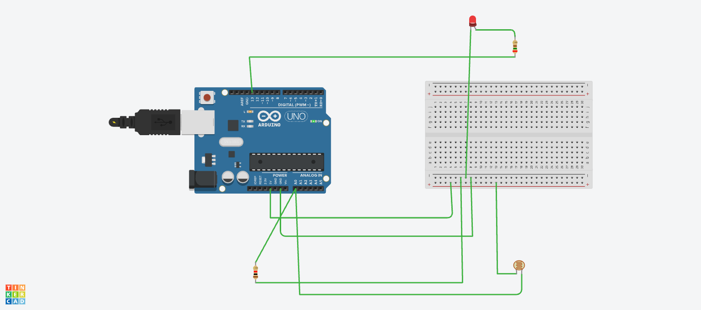

# LDR Sensor with LED - Arduino Project

## Aim
To automatically turn ON the LED in darkness and turn it OFF in light using an LDR sensor.

## Components Used
- Arduino Uno R3
- LDR (Photoresistor)
- LED
- Resistor 10k ohm (for LDR)
- Resistor 220 ohm (for LED)
- Breadboard + Jumper Wires

## Circuit Diagram

## How it Works
1. LDR senses the light intensity and gives a value from 0 to 1023
2. If value < 500 (Darkness) -> LED turns ON
3. If value > 500 (Light) -> LED turns OFF
4. Value is checked every 1 second

## Code
The code is available in `code.ino` file.

## Tested On
Tinkercad Simulator
